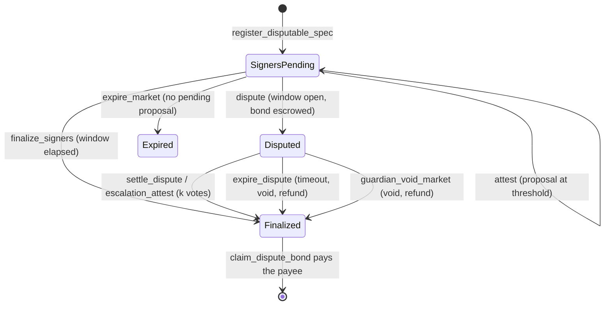

# Architecture

See the top-level diagram in [README.md](../README.md#architecture) for the
system at a glance. This doc goes one level deeper into each contract's
responsibilities and the invariants that hold across them.

## Contracts

### market-core

The hub: every binary market lives here as one entry in persistent storage,
keyed by `market_id`. Pricing is a Gnosis-style constant-product FPMM over
internal YES/NO share accounting — no external LP token, no AMM pool
contract per market. `contracts/market-core/src/math.rs` is the entire
pricing engine, pure integer arithmetic, no `Env` dependency, so it's
natively unit-testable and mirrored line-for-line in
[`model/fpmm_model.py`](../model/fpmm_model.py) and
`agents/core/fpmm.ts` for property testing and off-chain quoting.

The collateral token's `decimals()` is read once in the constructor and
stored in instance storage (`DataKey::Decimals`), supporting `0 ..= 18`.
It is exposed through `Config.decimals` and a dedicated view. The economic
bounds are derived from it (`math::bounds_for_decimals`):
`min_seed = 100 * 10^d` and `max_sets = 1e8 * 10^d`. The derived bounds
replace the old hardcoded 7-decimal `MIN_SEED` / `MAX_SETS` constants in
contract logic. At 18 decimals `max_sets` is `1e26`, so products of two
quantities reach `1e52` — beyond `ii28`. That is why `mul_div_floor` /
`mul_div_ceil` use 256-bit intermediates (a small no_std `u128x2`
widening multiply and divide inside `math.rs`), so a result that fits in
`ii28` is always returned exactly and correctness no longer depends on a
1e30 headroom argument. Rounding directions are unchanged. The Python and
TypeScript mirrors also expose `bounds_for_decimals` / `boundsForDecimals`
and assert that results fit `i128`, so off-chain quotes fail where the
contract would.

Sums of shares and reserves stay far below `i128::MAX` at the maximum
supported decimals (`max_sets = 1e26`); `settle_value` uses checked
addition anyway and propagates the error through `redeem` /
`claim_pool_remainder`.

**Solvency invariant** (holds after every state transition — see the test
suite for the ones exercised): the contract's own SEP-41 token balance for a
market equals `sets_minted + fees_accrued + lp_fees` (`fees_accrued` is the
protocol's pending share of trading fees, `lp_fees` the creator's — see the
fee split below), and `reserve_yes + Σ(user yes positions) == sets_minted`
(symmetrically for `no`).

**Fee split and recipient snapshot.** `create_market` snapshots a
`FeeTerms { recipient, protocol_share_bps }` side entry per market, so
`set_treasury` / `set_protocol_fee_share_bps` only affect markets created
after them. Each trade's fee is split once at accrual time
(`math::split_fee`, protocol shares round up so `protocol + lp == fee`
exactly): the protocol portion accumulates in `Market.fees_accrued` and is
swept to the snapshotted recipient by the permissionless `sweep_fees`
(old `FeesSwept` event kept for indexers, plus `FeesSweptTo`); the creator
portion accumulates in a `LpFees(market_id)` side entry, claimable any time
(before finality too) via `claim_lp_fees`, and also drained by
`claim_pool_remainder`. Markets created before this change have no
`FeeTerms` entry and fall back to the old behavior: recipient = whatever
`DataKey::Treasury` retains at sweep time, `protocol_share_bps = 10_000` —
fully backward compatible, no migration transaction needed. The separate
LP balance (rather than adding fees to the reserves) is deliberate: it does
not move `k` or the price and maps directly onto the per-LP fee accumulator
of the future multi-LP design ([wave-issue 02](wave-issues/02-multi-lp-liquidity.md)).

**Trade bounds and circuit breakers.** Two layers of protection beyond the
share-count slippage parameters:

- *Deadline + limit price* (#12): `buy_v2` / `sell_v2` take a
  `deadline` (ledger **(timestamp**, unix seconds) checked before anything
  else, and a `limit_price_bps` bounding the **average execution price**
  (`collateral_in / shares_out` for buys, `collateral_out / shares_in` for
  sells, fee included, compared by cross-multiplication). `0` means "no
  limit" for buys; for sells it is trivially satisfied and buys no
  protection. The original `buy` / `sell` remain as thin wrappers for
  backward compatibility (same body, no bounds).
- *Per-market breakers* (#10): `BreakerConfig { max_impact_bps, band_bps }`
  is snapshotted per market from an admin default (`set_default_breaker`,
  which rejects `band_bps < max_impact_bps` because that makes one trade
  cover the whole band). `max_impact_bps` bounds a single trade's
  |post − pre| YES-price move (`>` — a trade moving exactly the cap
  passes); `band_bps` bounds |post − ledger-open price|, with the reference
  stored in short-TTL **(temporary** storage keyed by ledger sequence, so
  it resets by itself every ledger. 0 disables either check; legacy markets
  have no config and are unaffected. Breaker trips revert with
  `PriceImpactTooHigh` / `PriceBandExceeded` and — because Soroban rolls
  back an invocation's events on `Err` — emit **no** event (the error codes
  and the `would_trip` / `breaker_config` / `breaker_state` views are the
  observability path; see the comment on `check_breakers`).

  *Worst-case lock cost.* The band cannot be ratcheted: the reference is
  the ledger-open price, so an attacker who pushes the price to the band
  edge only blocks further trades for the rest of that ledger (~5 s) —
  and pays the trading fee plus price impact to do it, which arbitrageurs take back the next ledger. The breakers cannot lock a market across

  ledgers by construction.

**Transferability.** `transfer_position(from, to, market_id, outcome,
amount)` moves shares between any two addresses (owner auth; allowed while
`Paused` — a transfer moves no collateral — and after finality until
`redeem`), rejecting self-transfers, transfers to the contract's own
address (they could never be redeemed) and over-transfers, and emitting
`PositionTransferred` so indexers stay in sync. `transfer_lp(market_id,
new_creator)` (current-creator auth, until `lp_claimed`) moves the single
LP role — the right to `claim_pool_remainder` and `claim_lp_fees` — and
emits `LpTransferred`. Both preserve the solvency invariant by
construction; the position mapping is unchanged down to the "remove zero entries" rule.

**Resolution commitment**: `resolution_hash` is fixed at `create_market`
time — see [ADR 0001](adr/0001-resolution-commitment.md) for why.

Lifecycle: `create_market` → `buy`/`sell` (while open; `buy_v2`/`sell_v2`
with bounds) → `resolve` or `void_market` (resolver-only) → `redeem` per
holder, `claim_pool_remainder` for the creator/LP, `sweep_fees`
(permissionless) to the snapshoted fee recipient. Positions and LP
ownership can change hands at any point via `transfer_position` /
`transfer_lp`.

### resolver

Independent resolution modes, all ultimately calling
`market_core.resolve(market_id, outcome)`:

- **PriceThreshold**: reads a [Reflector](https://reflector.network) SEP-40
  price feed at (or after) the market's `close_time`, compares to a
  threshold, enforces a max staleness window.
- **Attested**: m-of-n signer votes; once `threshold` signers agree, a
  dispute window opens; anyone can finalize after it elapses, or a guardian
  (the resolver's `admin`) can `cancel_proposal` during the window.
- **Weighted keys**: a committee of raw Ed25519 public keys with weights.
  Members sign a domain-separated message off-chain and anyone submits the
  signatures to `submit_signatures` in one transaction; the weight threshold
  starts the same dispute window. `cancel_proposal` moves the market to a new
  round, invalidating earlier signatures. Message format: ADR 0001.

Neither mode can be configured until the revealed spec's hash matches the
market's commitment (`register_price_spec` / `register_signer_spec` — see
ADR  0001). A guardian can also `guardian_void_market` an unresolvable
market directly.

#### Bonded disputes (`SignersDisputable`)

A `SignersDisputable` spec adds an optimistic challenge to Attested mode.
While a proposal's dispute window is open, anyone can `dispute` it by
escrowing `dispute_bond` of the collateral token in the resolver. That
freezes `finalize_signers`, `attest`, `cancel_proposal` and `expire_market`
dispute active (`DisputeActive`) and escalates to the authority committed in the spec: the
guardian (`settle_dispute`) or a `k`-of-`n` committee disjoint from the
signers (`escalation_attest`). Upholding the proposal resolves to it and
forfeits the bond to market-core's treasury; any other ruling resolves to the
verdict (or voids for `Invalid`) and returns the bond. If nobody rules within
escalation timeout of the dispute, anyone may `expire_dispute`: the market is
voided and the bond refunded. `guardian_void_market` during a dispute also
refunds it. Bonds leave escrow only via the permissionless
`claim_dispute_bond` (pull, so a payee that cannot receive cannot block
settlement); the resolver's token balance always equals the bonds it still
holds.

**Rewards, honestly:** a winning disputer only gets their bond back. The
resolver holds no funds besides bonds, so there is nothing to pay a reward
from until signers also post bonds (signer staking is separate work). The
incentive to dispute is therefore protecting one's own position, not profit.

Liveness: `resolution_deadline` is `close_time` + 30 days. After it anyone can
call `expire_market`, which resolves the market if it still can be (valid
price feed) and otherwise voids it through market-core, so collateral is never
locked behind a missing reveal or a silent committee. See ADR 0001.

The resolver never depends on `market-core`'s Rust crate — see
[ADR 0002](adr/0002-cross-contract-calls.md) for why, and what that trades
off. The vendored `market_core.wasm` fixture is refreshed whenever
market-core changes.

### treasury

Holds the agents' pooled USDC and is the *only* path that spends it: an
agent calls `agent_create_market` / `agent_buy` / `agent_sell` /
`agent_buy_v2` / `agent_sell_v2`, the treasury checks its own
per-trade/per-market/daily caps, then calls `market-core` itself as the
trader/creator. This means the caps are a real on-chain limit on what the
automated agent can deploy — an agent's own key calling `market-core`
directly would just be trading its own separate funds, not bypassing a cap
on the treasury's money. The `*_v2` twins forward the same caps plus
market-core's deadline / limit-price bounds, so a revert from either layer
laves the caps unchanged (the whole invocation is atomic). The treasury's
creator-side claims are split the same way the fees are: `collect_market_fees`
sweeps the **protocol portion** to the treasury, while `agent_claim_lp_fees`
claims the LP portion for markets the treasury created.

**Migration to a successor treasury.** The treasury has no upgrade path or
config setters by design, so redeploying it (bug fix, cap change, agent
rotation) means deploying a new contract. `set_successor(successor)`
(admin) records where value may go and emits `SuccessorSet`; then
`migrate_market(market_id)` (admin, **not** agent) moves the treasury's
`...
